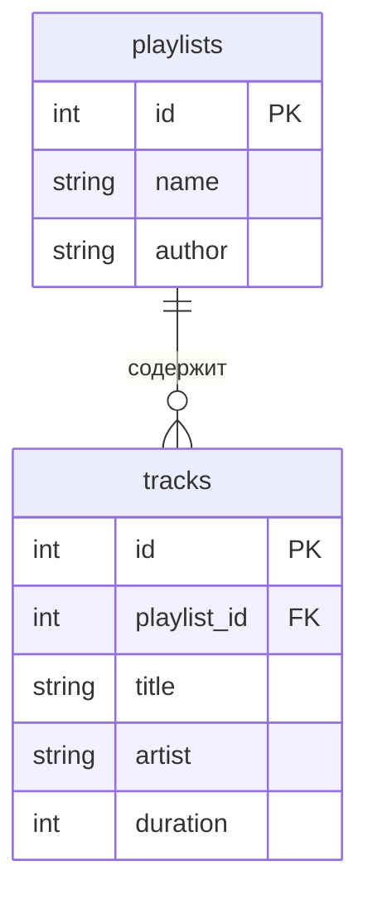

### Backend музыкального плейлиста
Тема №2: **Музыкальные плейлисты**. Сервис для создания и управления музыкальными подборками.

| | |
| ------ | ------ |
| Главная сущность | Плейлист |
| Связанная сущность (1:N) | Трек |
| Фишка | Запрет на добавление дубликатов треков (409) |
| Стек | Python, FastAPI, SQLAlchemy, Alembic, SQLite |

#### Как запустить
```
git clone https://github.com/DelLock/BackendPlaylistMusic.git
cd BackendPlaylistMusic
python -m venv .venv
.\.venv\Scripts\Activate.ps1
python -m pip install -r requirements.txt
copy .env.example .env
alembic upgrade head
python seed.py
uvicorn main:app --reload --host 127.0.0.1 --port 8000
```
`alembic upgrade head` создаёт таблицы из миграций, `python seed.py` заполняет пустую базу тестовыми данными (повторный запуск ничего не дублирует).

Сервис работает на http://localhost:8000 . Swagger UI: http://localhost:8000/docs . Запросы для демонстрации лежат в `requests.http`.

Строка подключения к базе читается из переменной окружения `DATABASE_URL` (файл `.env`, шаблон в `.env.example`).

#### Эндпоинты
| Метод | Путь | Что делает | Ответ |
| ------ | ------ | ------ | ------ |
| GET | /health | Проверка, что сервис жив | 200 {"status":"ok"} |
| POST | /api/playlists | Создать плейлист | 201 и объект с id; 400 при ошибке |
| GET | /api/playlists | Список. Параметры: `limit`, `offset`, `q` (поиск по названию), `author` (фильтр) | 200 |
| GET | /api/playlists/{id} | Получить плейлист | 200; 404 |
| PATCH | /api/playlists/{id} | Изменить плейлист | 200; 400; 404 |
| DELETE | /api/playlists/{id} | Удалить плейлист вместе с треками | 204; 404 |
| POST | /api/playlists/{id}/tracks | Добавить трек в плейлист | 201; 400; 404; 409 (такой трек уже есть) |
| GET | /api/playlists/{id}/tracks | Список треков плейлиста | 200; 404 |
| DELETE | /api/playlists/{id}/tracks/{track_id} | Удалить трек | 204; 404 |
| GET | /api/playlists/stats | Статистика по всем плейлистам: число треков и общая длительность | 200 |
| GET | /api/playlists/{id}/stats | Статистика одного плейлиста | 200; 404 |

Ошибки приходят в формате `{"error": "текст", "field": "имя поля"}`.

#### ER-диаграмма


#### Индексы и EXPLAIN
Самый частый запрос: получить все треки плейлиста (он же нужен для проверки дубликатов при добавлении трека). Под него миграцией `0001` создан индекс:

`CREATE INDEX ix_tracks_playlist_id ON tracks (playlist_id);`

Запрос:

`EXPLAIN QUERY PLAN SELECT * FROM tracks WHERE playlist_id = 1;`

Результат SQLite:

`SEARCH tracks USING INDEX ix_tracks_playlist_id (playlist_id=?)`

Без индекса база читала бы всю таблицу (`SCAN tracks`).

Также создан индекс `ix_playlists_name` на `playlists (name)`.
