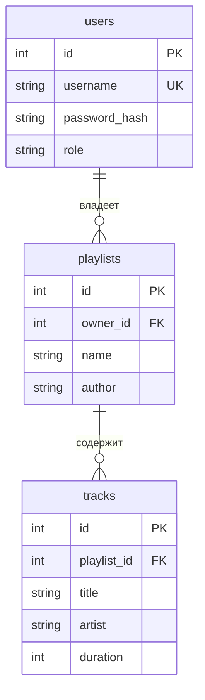

### Backend музыкального плейлиста
Тема №2: **Музыкальные плейлисты**. Сервис для создания и управления музыкальными подборками.

| | |
| ------ | ------ |
| Главная сущность | Плейлист |
| Связанная сущность (1:N) | Трек |
| Фишка | Запрет на добавление дубликатов треков (409) |
| Стек | Python, FastAPI, SQLAlchemy, Alembic, SQLite, bcrypt, PyJWT |

#### Как запустить
```
git clone https://github.com/DelLock/BackendPlaylistMusic.git
cd BackendPlaylistMusic
python -m venv .venv
.\.venv\Scripts\Activate.ps1
python -m pip install -r requirements.txt
copy .env.example .env
alembic upgrade head
python seed.py
uvicorn main:app --reload --host 127.0.0.1 --port 8000
```
`alembic upgrade head` создаёт таблицы из миграций, `python seed.py` создаёт администратора и заполняет пустую базу тестовыми данными (повторный запуск ничего не дублирует).

Сервис работает на http://localhost:8000 . Swagger UI: http://localhost:8000/docs . Запросы для демонстрации лежат в `requests.http`.

Настройки читаются из переменных окружения (файл `.env`, шаблон в `.env.example`):

| Переменная | Что это |
| ------ | ------ |
| `DATABASE_URL` | Строка подключения к базе |
| `JWT_SECRET` | Секрет для подписи токенов. Если не задан, берётся случайный и после перезапуска токены перестают работать |
| `JWT_EXPIRE_MINUTES` | Сколько минут живёт токен (по умолчанию 30) |
| `ADMIN_USERNAME`, `ADMIN_PASSWORD` | Администратор, которого создаёт `python seed.py` |

#### Эндпоинты
Колонка «Доступ»: **все** это без входа, **вход** это любой вошедший пользователь, **владелец** это автор плейлиста или админ.

| Метод | Путь | Что делает | Доступ | Ответ |
| ------ | ------ | ------ | ------ | ------ |
| GET | /health | Проверка, что сервис жив | все | 200 {"status":"ok"} |
| POST | /auth/register | Регистрация (`username`, `password`) | все | 201 и пользователь без пароля; 400; 409 (логин занят) |
| POST | /auth/login | Вход, выдаёт JWT | все | 200 `{"access_token": "...", "token_type": "bearer", "expires_in": 1800}`; 401; 429 |
| GET | /auth/me | Текущий пользователь | вход | 200 (`id`, `username`, `role`); 401 |
| POST | /api/playlists | Создать плейлист, `owner_id` ставит сервер | вход | 201 и объект с id; 400; 401 |
| GET | /api/playlists | Список. Параметры: `limit`, `offset`, `q` (поиск по названию), `author` (фильтр) | все | 200 |
| GET | /api/playlists/{id} | Получить плейлист | все | 200; 404 |
| PATCH | /api/playlists/{id} | Изменить плейлист | владелец | 200; 400; 401; 403; 404 |
| DELETE | /api/playlists/{id} | Удалить плейлист вместе с треками | владелец | 204; 401; 403; 404 |
| POST | /api/playlists/{id}/tracks | Добавить трек в плейлист | владелец | 201; 400; 401; 403; 404; 409 (такой трек уже есть) |
| GET | /api/playlists/{id}/tracks | Список треков плейлиста | все | 200; 404 |
| DELETE | /api/playlists/{id}/tracks/{track_id} | Удалить трек | владелец | 204; 401; 403; 404 |
| GET | /api/playlists/stats | Статистика по всем плейлистам: число треков и общая длительность | все | 200 |
| GET | /api/playlists/{id}/stats | Статистика одного плейлиста | все | 200; 404 |

Ошибки приходят в формате `{"error": "текст", "field": "имя поля"}`, у ошибок доступа (401, 403, 409, 429) поля `field` нет.

#### Пользователи и доступ
- **Вход.** Работают два способа: заголовок `Authorization: Basic <base64(логин:пароль)>` и `Authorization: Bearer <токен>`, токен выдаёт `POST /auth/login`. В Swagger UI (`/docs`) кнопка Authorize принимает оба.
- **Пароли** хранятся только хэшем bcrypt (`security.py`), в ответах API хэша нет. Пароль от 6 символов, не длиннее 72 байт (ограничение bcrypt). Для неизвестного логина и для неверного пароля ответ одинаковый (401 `Invalid credentials`), и время ответа тоже.
- **JWT.** Подпись HS256, внутри id пользователя и срок жизни. Секрет и срок берутся из окружения. Подделанный, просроченный и битый токены дают 401.
- **Владелец записи.** `owner_id` ставит сервер по тому, кто вошёл, значение из тела запроса игнорируется. Изменять и удалять плейлист и его треки может только владелец, остальным 403. Плейлисты, созданные до появления пользователей, остались без владельца: менять их может только админ.
- **Админ.** Роль `admin` может менять и удалять любые плейлисты. Админа создаёт `python seed.py` из `ADMIN_USERNAME` и `ADMIN_PASSWORD`, через регистрацию админом стать нельзя: роль в теле запроса не читается.
- **Лимит попыток.** После 5 неудачных входов за минуту для одной пары «адрес клиента + логин» сервер отвечает 429 с заголовком `Retry-After`, даже если пароль верный. Успешный вход сбрасывает счётчик. Счётчики хранятся в памяти процесса.
- **Где проверяется доступ.** В `dependencies.py`: `get_current_user` решает, кто пришёл (401), `get_playlist_for_write` проверяет плейлист и права (404, 403). Роутеры только подключают эти зависимости.

#### ER-диаграмма


#### Индексы и EXPLAIN
Самый частый запрос: получить все треки плейлиста (он же нужен для проверки дубликатов при добавлении трека). Под него миграцией `0001` создан индекс:

`CREATE INDEX ix_tracks_playlist_id ON tracks (playlist_id);`

Запрос:

`EXPLAIN QUERY PLAN SELECT * FROM tracks WHERE playlist_id = 1;`

Результат SQLite:

`SEARCH tracks USING INDEX ix_tracks_playlist_id (playlist_id=?)`

Без индекса база читала бы всю таблицу (`SCAN tracks`).

Также создан индекс `ix_playlists_name` на `playlists (name)`.
