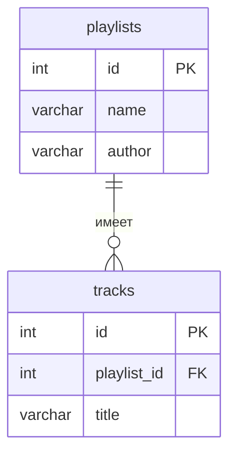

### Backend музыкального плейлиста
Тема №1: **Музыкальные плейлисты** . Сервис для создания, управления и прослушивания музыкальных подборок.
| | |
| ------ | ------ |
| Главная сущность | Плейлист |
| Связанная сущность (1:N) | Трек |
| Фишка | Запрет на добавление дубликатов треков |
| Стек | Python, FastAPI |

#### Как запустить
```
git clone https://github.com/DelLock/BackendPlaylistMusic.git
cd BackendPlaylistMusic
python -m venv .venv
.\.venv\Scripts\Activate.ps1
python -m pip install -r requirements.txt
uvicorn main:app --reload --host 127.0.0.1 --port 8000
```
Сервис работает на http://127.0.0.1:8000 . Запросы для демонстрации лежат в requests.http .

#### Эндпоинты
| Метод | Путь | Что делает | Ответ |
| ------ | ------ | ------ | ------ |
| GET | /health | Проверка, что сервис жив | 200 {"status":"ok"} |
| POST | /api/items | Создать | 201 и объект с id ; 400 при ошибке |
| GET | /api/items | Список | 200 |
| GET | /api/items/{id} | Получить одну запись | 200; 404 |
| PATCH | /api/items/{id} | Изменить | 200; 400; 404 |
| DELETE | /api/items/{id} | Удалить | 204; 404 |

#### ER-диаграмма

#### Интерфейс
